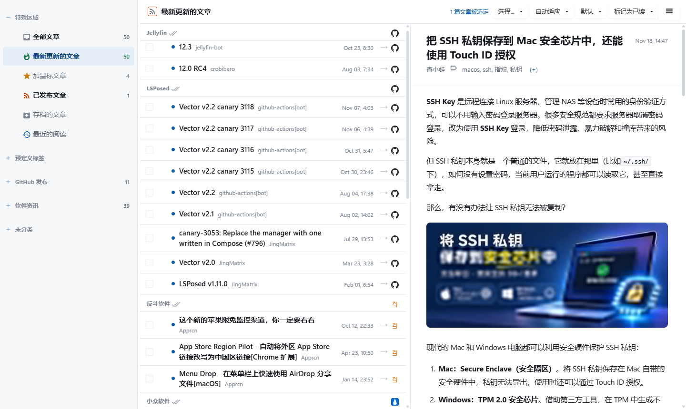

# TTRSS 维护版

自动跟进上游 Awesome-TTRSS / TT-RSS（每小时同步，测试通过后发布镜像），集成密钥挂载式 bridge、1/3/5/10 分钟刷新选项和非标准端口订阅（源码补丁，构建时打入），并保持 nginx 等系统组件的安全更新。

完整说明、更新流程、部署边界见 **[MAINTENANCE.md](MAINTENANCE.md)**。

## 内置主题：enterprise

镜像额外提供现代企业风格主题 `enterprise`（浅色）、`enterprise_night`（深色）和 `enterprise_auto`（跟随系统）。主题按用户在"偏好设置 → 主题"里自选，不改默认值，也不改现有用户的选择；随时可以选回原来的主题或"默认"。如果界面异常，可在登录页勾选"安全模式"，用默认界面登录。详见 [themes/enterprise/README.md](themes/enterprise/README.md)。

- 上游容器项目：[HenryQW/Awesome-TTRSS](https://github.com/HenryQW/Awesome-TTRSS)
- 上游应用：[tt-rss/tt-rss](https://github.com/tt-rss/tt-rss)
- [上游原 README](docs/README.upstream.md)
- 镜像：`ghcr.io/jiemo9527/ttrss:<sha7>` / `latest`

本仓库不包含生产密钥、数据库或真实部署配置。镜像发布不等于线上部署。
